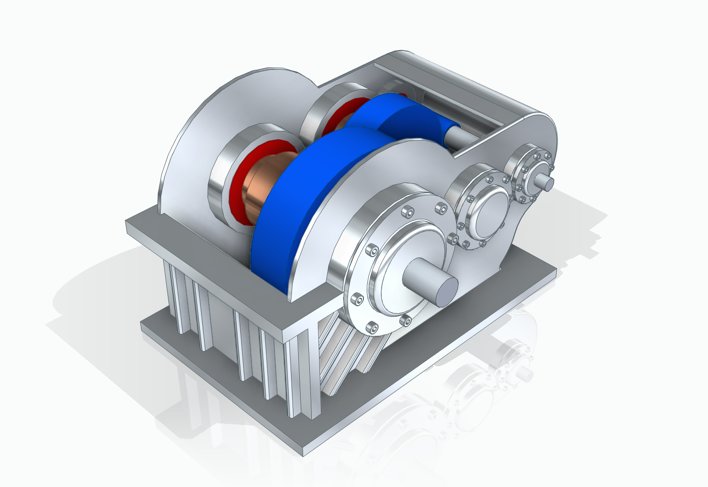

# 减速机课程设计

> 带式输送机用两级圆柱齿轮减速器设计（电动机 + V带 + 二级齿轮减速）

## 项目概述

本课程设计针对**带式输送机**开发一套**电动机 + V带传动 + 二级圆柱齿轮减速器**的传动系统。  
采用同轴式布局，结构紧凑、传动平稳，满足输送带工作拉力 2000N、速度 1.3m/s 的设计要求，预期使用寿命 15 年。

**设计亮点**：
- 总减速比 i = 22（高速级 4.4，低速级 5）
- 选用汇川 MS1H2-40C30CD 4.0kW 抱闸伺服电机
- 小齿轮 12CrMnTi（渗碳淬火），大齿轮 45 钢（调质），模数 m=1mm
- 兼顾强度、工艺性与经济性

---

## 效果图

---
## 主要设计参数

| 项目                  | 参数值                  |
|-----------------------|-------------------------|
| 输送带工作拉力        | 2000 N                 |
| 输送带速度            | 1.3 m/s                |
| 卷筒直径              | 180 mm                 |
| 电机功率              | 4.0 kW（抱闸伺服）     |
| 电机转速              | 3000 rpm               |
| 总减速比              | 22                     |
| 齿轮模数              | 1 mm                   |
| 预期寿命              | 15 年                  |

---

## 使用方法

1. 查看 `设计说明书.pdf` 获取完整计算过程与结果
2. 浏览 `8-Picture/` 文件夹查看三维效果图、装配示意图及零件图
3. `Note/` 文件夹中包含中间计算与思考记录

---

## 保留内容

### logo与作者

- 作者：pinavia
- 

### 学习许可与权利保留

- 本项目允许个人、学校和研究者进行非商业性的学习、研究和引用。
- 未经著作权人书面许可，不得将项目内容用于商业开发、产品制造、商业服务、商业宣传、投标交付、毕业设计成品交付或再授权。
- 不得删除作者、来源、版本历史和第三方许可证声明，不得将本项目或其衍生成果宣称为与作者无关的原创项目。
- 软件源码适用 [PolyForm Noncommercial 1.0.0](https://polyformproject.org/licenses/noncommercial/1.0.0/)；机械模型、PCB、原理图、图片、文档、Unity 工程和其他非软件资料适用 [CC BY-NC-ND 4.0](https://creativecommons.org/licenses/by-nc-nd/4.0/)。
- SE、SW、STEP/STP 及其他三维模型仅允许个人或学校进行非商业学习、评审和研究；未经著作权人书面许可，不得用于加工、打样、制造、销售、量产、投标、产品交付、商业宣传、改作或再授权。
- 第三方组件、模板、元件库、外购件模型和工具仍受其原始许可证约束；本声明不扩大作者对第三方内容的权利。

商业使用、产品化、公司内部长期使用、转让或排他性授权需另行取得著作权人的书面许可。
